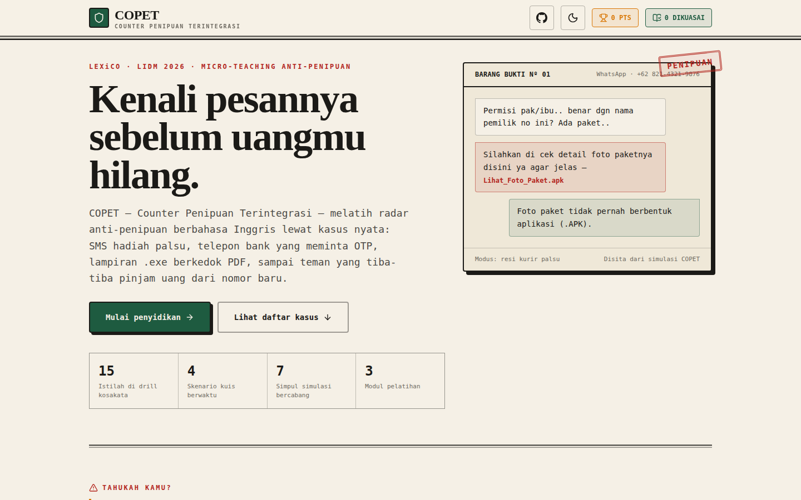
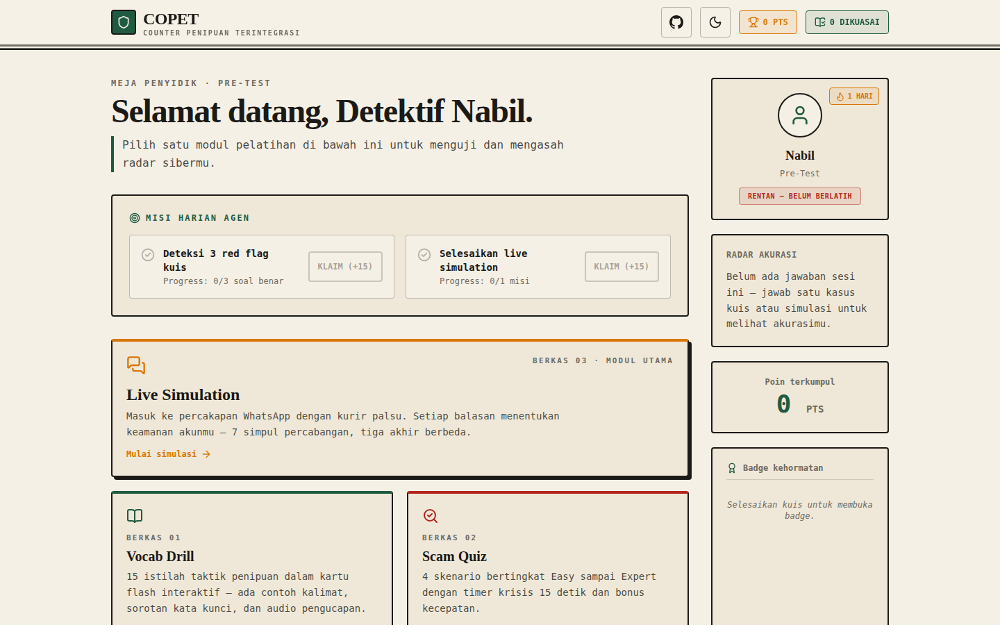
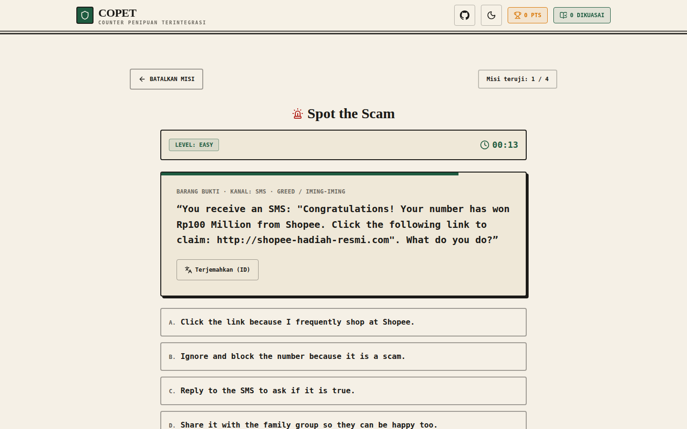
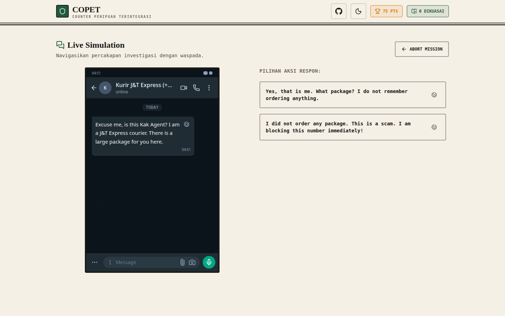

# COPET — Counter Penipuan Terintegrasi

**LEXiCO (Literacy & English Critical Observation)** — platform micro-teaching
gamified untuk LIDM 2026: melatih siswa SMA ke atas mengenali penipuan
berbahasa Inggris lewat kasus nyata. Metode pengembangan **ADDIE**
(Analysis, Design, Development, Implementation, Evaluation).



**Live:** https://lidm-copet.pages.dev

## Apa yang dilatih

| Modul | Isi (data asli repo) |
|---|---|
| **Vocab Drill** | 15 istilah taktik penipuan — flashcard bilingual + TTS + sorot kata kunci + tandai dikuasai |
| **Spot the Scam** | 4 skenario kuis adaptif Easy → Expert (SMS hadiah Shopee, telepon Bank BCA minta OTP, email HRD lampiran `Form_Interview.exe`, chat WhatsApp teman pinjam uang) — timer 15 detik, poin 10 + sisa waktu × 5, lalu fase pelaporan 3 langkah ke [aduannomor.id](https://aduannomor.id), +25 PTS |
| **Live Simulation** | Percakapan WhatsApp bercabang dengan kurir J&T palsu (`.apk`) — 7 simpul, 3 akhir berbeda |

Dashboard: misi harian (klaim +15 PTS), streak hari aktif berurutan, badge
(SCAM SURVIVOR / SCAM HUNTER / ZERO TOLERANCE), sertifikat kelulusan
(≥ 10 PTS, cetak via `window.print`). Panel evaluator: log skor semua
sesi untuk pre-test / post-test. Semua data tersimpan di **localStorage** —
tidak ada backend, tidak ada akun, tidak ada kata sandi.

> **Catatan kejujuran angka:** versi lama menampilkan "87% deteksi",
> streak "3 HARI", dan statistik "235 juta pengguna / Rp 476 miliar /
> peringkat ke-2 di dunia" tanpa sumber. Semuanya sudah dihapus atau
> diganti hitungan nyata dari data sesi (lihat
> [CHANGELOG.md](CHANGELOG.md)).

## Cara jalan

```bash
npm install
npm run dev        # http://localhost:5173
npm run build      # produksi ke dist/
npm run preview    # pratinjau build di http://127.0.0.1:4173
```

Node ≥ 22. Tanpa `.env` — tidak ada layanan eksternal yang butuh kunci.

## Tampilan

| Landing | Dashboard | Kuis | Simulasi |
|---|---|---|---|
|  |  |  |  |

Video demo: [docs/demo/demo.mp4](docs/demo/demo.mp4) (12 adegan, 1280×720).

## Teknologi

Vite 8 + React 19 + TypeScript + Tailwind CSS v4 + framer-motion +
lucide-react. Desain: "halaman depan koran berkas perkara" — Fraunces +
IBM Plex Mono, 6 warna bernama, stempel miring PENIPUAN, nomor perkara
`PERKARA Nº COPET-2026-…` (lihat [docs/DESIGN.md](docs/DESIGN.md);
referensi: template **Tipline** di Framer).

## Tes

```bash
npm run typecheck   # tsc
npm run lint        # eslint
npm run validate    # gate anti-slop P0 + link preview (og:/twitter:)
npm run smoke       # cek build produksi (HTTP + OG + aset)
npm run e2e         # Playwright: landing → login → dashboard → vocab → kuis → simulasi → admin (desktop + mobile)
```

Detail: [docs/testing.md](docs/testing.md).

## Dokumen

- [docs/PRD.md](docs/PRD.md) — PRD lengkap (ADDIE, 8 strategi linguistik, formula skor)
- [docs/DESIGN.md](docs/DESIGN.md) — kontrak arah desain
- [docs/ARCHITECTURE.md](docs/ARCHITECTURE.md) — arsitektur & struktur folder
- [docs/API.md](docs/API.md) — model data & API engine lokal
- [docs/deploy.md](docs/deploy.md) — deploy Cloudflare Pages + link preview
- [docs/diagrams.html](docs/diagrams.html) — diagram alur & arsitektur (HTML+SVG)

## Lisensi

MIT — lihat [LICENSE](LICENSE).
